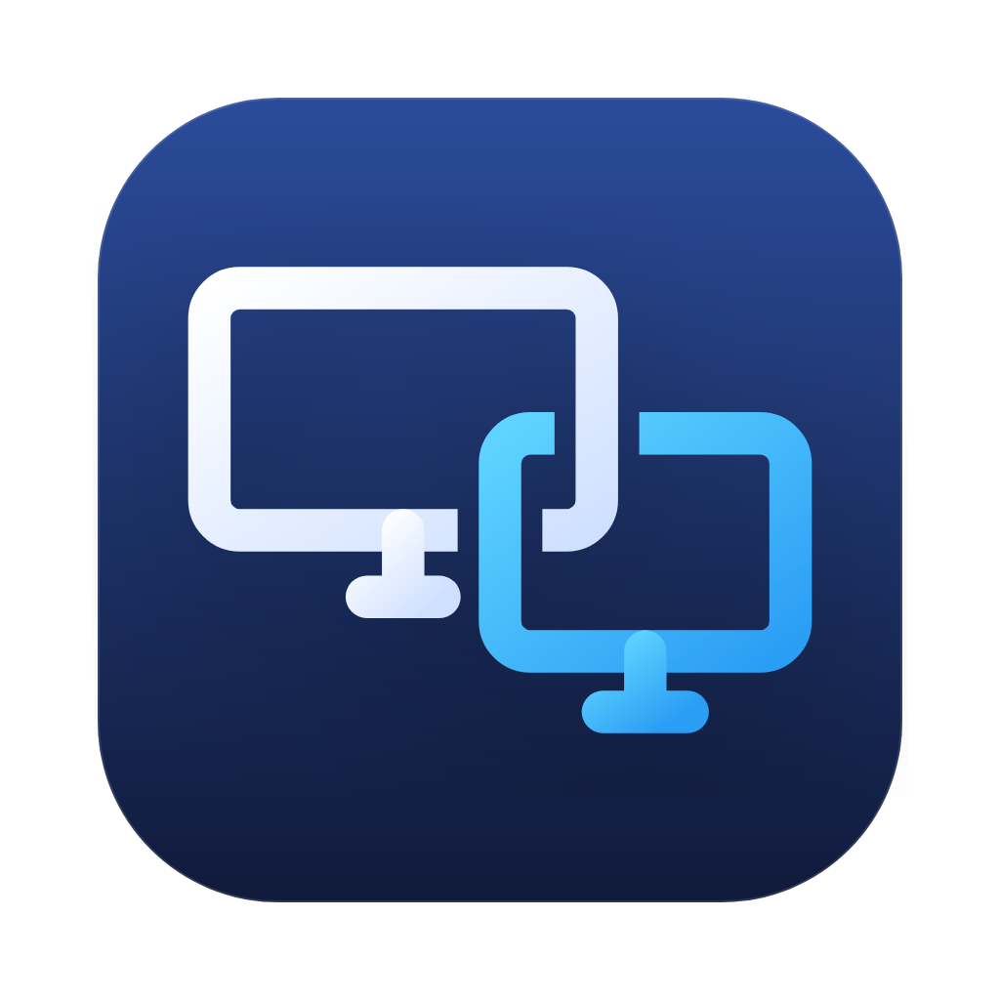

<p align="center"></p>

# Display Manager

Eine kleine Hintergrund-App für macOS, die nur in der Menüleiste lebt. Sie merkt sich **dauerhaft alle Bildschirme** und **für jede App und jedes Fenster, auf welchem Bildschirm es zuletzt in welcher Größe offen war**. Öffnest du die App später wieder, z. B. nach einem Neustart, setzt Display Manager das Fenster automatisch zurück an diese Stelle.

**Beispiel:** Photoshop öffnet sich auf dem MacBook-Bildschirm. Du ziehst es auf Bildschirm 3 und vergrößerst es, schließt Photoshop und fährst den Mac herunter. Nach dem Neustart öffnest du Photoshop, und Display Manager setzt das Fenster auf Bildschirm 3, in der zuletzt genutzten Größe.

## Funktionen

- **Nur Menüleiste:** kein Dock-Symbol und kein Widget.
- **Startet automatisch beim Anmelden.** Das ist beim ersten Start schon aktiviert und lässt sich in den Einstellungen abschalten.
- **Merkt sich alle Bildschirme** über eine stabile Kennung (Hersteller, Modell und Seriennummer), auch wenn sie gerade nicht angeschlossen sind.
- **Merkt sich Fenster** je App: Bildschirm, Position und Größe. Ein Fenster wird über die Dokument-Datei, den Fenstertitel oder als zuletzt genutztes Fenster der App wiedererkannt.
- **Speichert getrennt pro Bildschirm-Kombination.** „MacBook allein“ und „MacBook + 2 Monitore“ haben jeweils eigene Positionen.
- **Prüft nach.** Auch Apps, die sich ihre Position selbst merken, werden nach dem Öffnen mehrmals kontrolliert (nach etwa 0,25 s, 0,9 s, 2 s und 3,5 s) und bei Bedarf korrigiert. Ziehst du das Fenster in dieser Zeit selbst, hat deine Bewegung Vorrang.
- **Holt Fenster zurück,** wenn du Monitore an- oder absteckst oder der Mac aus dem Ruhezustand aufwacht.
- **Updates** lassen sich unter *Einstellungen › Updates* ansehen und installieren. Die App sucht alle 6 Stunden selbst nach Updates, lädt sie und installiert sie beim nächsten Start (z. B. nach einem Neustart des Mac).
- **Apps ignorieren oder vergessen** unter *Einstellungen › Apps*.

## Photoshop: Duplikat auf dem 2. Bildschirm

Gedacht für die Arbeit an einem Grafiktablett mit Bildschirm (z. B. Wacom): Auf dem Tablett arbeitest du hineingezoomt, auf dem zweiten Bildschirm siehst du live die Übersicht.

**Ein Knopfdruck** (Standard: Taste **F13**) löst diese Schritte aus:

1. **Fenster › Anordnen › Neues Fenster für „…“**: eine zweite *Ansicht* desselben Dokuments, kein neues Dokument und keine Ebene.
2. **Fenster › Anordnen › In Fenster verschiebbar machen**: löst das Duplikat aus der Reiterleiste.
3. Das Duplikat wird auf den in *Einstellungen › Photoshop* gewählten Bildschirm gelegt, und **das Fenster füllt den Bildschirm ganz aus**.
4. Optional **Ansicht › Ganzes Bild**, damit das Duplikat die Übersicht zeigt.
5. Der Fokus springt zurück auf das Original. Du arbeitest sofort weiter.

Ist in Photoshop „Zoomen verändert Fenstergröße“ aktiv, schrumpft „Ganzes Bild“ das Fenster auf Bildgröße. Display Manager zieht es danach automatisch wieder bildschirmfüllend auf.

Ist das Duplikat schon offen, wird es nur wieder auf den Zielbildschirm gelegt, ohne ein zweites zu erzeugen. Display Manager klickt dabei nur die Photoshop-Menüs an, wie du es von Hand tun würdest. Es wird nichts in Photoshop installiert.

**Auslöser**
- **Taste:** F13 (Standard) oder eine eigene Taste unter *Einstellungen › Photoshop* aufnehmen.
- **Loupedeck CT:** einer Taste die Aktion **„Befehl ausführen“** zuweisen und als Pfad die Befehls-App wählen:
  `~/Library/Application Support/Display Manager/Befehle/Photoshop-Duplikat.app`
  Display Manager legt sie selbst an. Unter *Einstellungen › Photoshop* gibt es dafür „Pfad kopieren“ und „Im Finder zeigen“; im Dateiauswahl-Dialog öffnet ⇧⌘G das Feld zum Einfügen des Pfads. Die App startet unsichtbar (kein Fenster, kein Dock, kein Terminal), löst den Befehl aus und beendet sich sofort. Daneben liegt `Fenster wiederherstellen.app`.
- **Wacom ExpressKey:** Taste mit „Tastenanschlag“ F13 (bzw. deiner Taste) belegen.
- **Link-Befehl:** `displaymanager://photoshop-duplikat`. Er funktioniert z. B. in der Kurzbefehle-App („URL öffnen“), in jeder Software, die Links öffnen kann, oder im Terminal: `open displaymanager://photoshop-duplikat`.
- **Menüleiste:** „Photoshop-Duplikat auf 2. Bildschirm“.

Falls etwas nicht klappt, unter *Einstellungen › Photoshop* auf **„Diagnose kopieren“** klicken und den Text weitergeben. Er enthält die Menü- und Fensterdaten von Photoshop, aber keine Bildinhalte.

## Installation

1. Unter [Releases](https://github.com/ziege1988/Display-Manager/releases) die Datei `Display-Manager.zip` herunterladen und entpacken.
2. **„Display Manager.app“ in den Ordner „Programme“ ziehen.** Das ist wichtig, sonst kann sich die App nicht selbst aktualisieren.
3. Die App öffnen. Da sie nicht von Apple notariell beglaubigt ist (das kostet 99 €/Jahr), blockiert macOS den ersten Start:
   - **macOS 15 und neuer:** *Systemeinstellungen › Datenschutz & Sicherheit* öffnen, nach unten scrollen und bei „Display Manager“ auf **„Dennoch öffnen“** klicken.
   - **macOS 13/14:** Rechtsklick auf die App, dann **Öffnen** und noch einmal **Öffnen**.
   - Alternativ im Terminal: `xattr -dr com.apple.quarantine "/Applications/Display Manager.app"`
4. **Bedienungshilfen freigeben:** *Systemeinstellungen › Datenschutz & Sicherheit › Bedienungshilfen* öffnen und „Display Manager“ einschalten. Ohne diese Freigabe kann keine App fremde Fenster verschieben. Display Manager fragt beim Start danach und beginnt automatisch, sobald die Freigabe erteilt ist.

Display Manager braucht macOS 13 (Ventura) oder neuer und läuft auf Apple-Silicon- und Intel-Macs.

## Neue Version veröffentlichen (kostenlos über GitHub Actions)

1. Auf GitHub **Actions › Release › Run workflow** öffnen.
2. Eine Versionsnummer eingeben, z. B. `1.0.0`. Sie muss höher sein als die vorherige.
3. GitHub baut die App auf einem Mac in der Cloud, erstellt das Release `v1.0.0` und lädt die ZIP-Datei samt Prüfsumme hoch.
4. Installierte Apps finden das Update innerhalb von 6 Stunden, oder sofort über *Einstellungen › Updates › Jetzt prüfen*.

Jeder Push wird außerdem automatisch gebaut (Workflow **Build**). Das fertige ZIP liegt dann als Artefakt am jeweiligen Lauf.

> Für öffentliche Repositories sind die macOS-Runner von GitHub Actions kostenlos.

### Empfohlen: kostenloses eigenes Signierzertifikat

macOS bindet die Freigabe *Bedienungshilfen* an die Signatur der App. Ohne festes Zertifikat (Ad-hoc-Signatur) ändert sich die Signatur mit jedem Build, und **die Freigabe muss nach jedem Update neu erteilt werden.** Ein selbst erstelltes Zertifikat behebt das und kostet nichts:

1. Auf dem Mac im Projektordner ausführen: `./Scripts/create_signing_cert.sh`
2. Auf GitHub unter **Settings › Secrets and variables › Actions** zwei Secrets anlegen:
   - `SIGNING_CERT_P12`: der vom Skript ausgegebene Base64-Text (er liegt bereits in der Zwischenablage)
   - `SIGNING_CERT_PASSWORD`: das ausgegebene Passwort
3. Ab dem nächsten Release wird mit diesem Zertifikat signiert. Die Freigabe einmal neu erteilen, danach bleibt sie bei Updates erhalten.

Zusätzlich prüft der Updater dann, ob ein Update mit **demselben** Zertifikat signiert ist, und verwirft andere Updates.

### Meldung „Bedienungshilfen freigeben“, obwohl schon aktiviert

Dann gehört der Eintrag noch zu einer früheren Version. Ein- und Ausschalten hilft nicht. Lösung: in der Menüleiste bzw. unter *Einstellungen › Allgemein* auf **„Freigabe reparieren“** klicken und anschließend erneut freigeben. Von Hand geht es so: unter *Datenschutz & Sicherheit › Bedienungshilfen* „Display Manager“ mit **„−“** entfernen, die App neu starten und wieder freigeben. Im Terminal: `tccutil reset Accessibility io.github.ziege1988.displaymanager`.

Ab Version 0.2.2 werden Builds ohne Zertifikat mit einer festen Signatur-Anforderung (nur Bundle-ID) signiert, damit die Freigabe Updates überstehen soll.

## Selbst bauen

```bash
./Scripts/build_app.sh 0.1.0        # erzeugt build/Display Manager.app und build/Display-Manager.zip
```

Dafür braucht es die kostenlosen Xcode Command Line Tools (`xcode-select --install`).

## Wie es funktioniert

| Baustein | Aufgabe |
|---|---|
| `DisplayRegistry` | Kennt alle angeschlossenen Bildschirme und merkt sich jeden jemals gesehenen (`displays.json`). |
| `WindowTracker` / `AppObserver` | Beobachtet über die Accessibility-API, wie Fenster entstehen, verschoben, vergrößert und geschlossen werden. Sichert außerdem alle 30 Sekunden. |
| `WindowStore` | Speichert je App die Fenster mit Position relativ zum Bildschirm, getrennt nach Bildschirm-Kombination (`windows.json`). |
| `Updater` | Fragt GitHub Releases ab, prüft SHA-256 und Signatur, legt das Update bereit und tauscht die App beim nächsten Start aus. |

Die Daten liegen unter `~/Library/Application Support/Display Manager/`. Die Protokolle findest du in der App **Konsole**, wenn du nach `io.github.ziege1988.displaymanager` filterst.

## Bekannte Grenzen

- **Links/Browser-Tabs:** Browserfenster werden über ihren Titel wiedererkannt. Display Manager öffnet aber keine Links oder Apps selbst, sondern ordnet Fenster an, sobald sie geöffnet werden.
- **Vollbild, Dialoge, Paletten und minimierte Fenster** werden bewusst nicht verschoben.
- **Zwei baugleiche Monitore ohne Seriennummer** können dieselbe Kennung haben.
- Fenster auf anderen **Schreibtischen (Spaces)** meldet macOS teilweise erst, wenn der jeweilige Schreibtisch aktiv ist.
- Manche Apps (z. B. einige Java- oder Spiele-Apps) unterstützen die Accessibility-API nicht oder nur eingeschränkt.
